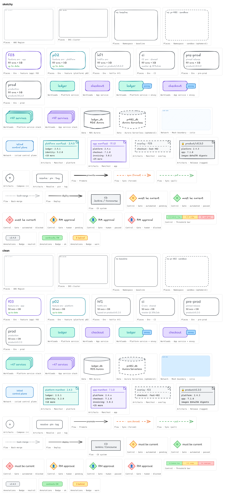
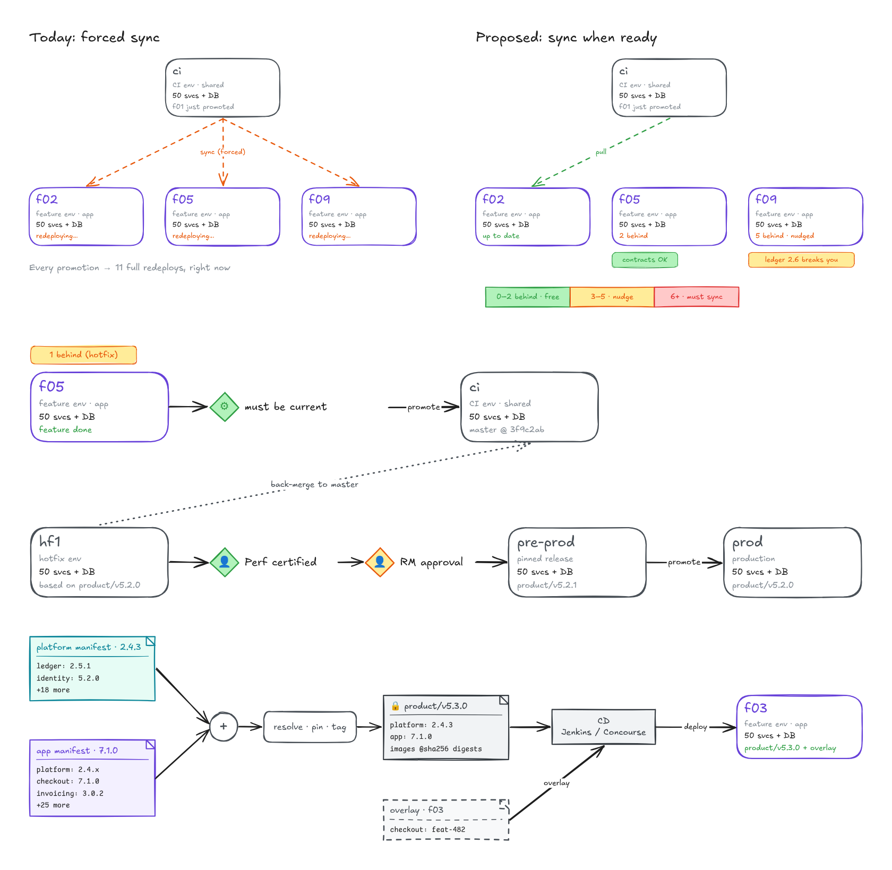

# Excalidraw kit

Platform-engineering components for Excalidraw, in two styles:

- `dist/pe-kit-sketchy.excalidrawlib` (hand-drawn)
- `dist/pe-kit-clean.excalidrawlib` (straight lines, normal font)



## Use it

1. Open [excalidraw.com](https://excalidraw.com).
2. Open the Library panel (book icon, top right), then use its menu to **Open** a `.excalidrawlib` file. Dragging the file onto the canvas also works.
3. Drag components onto the canvas. Double-click any text to rename it.

Tips:
- **Mesh boundary:** make it bigger than the namespaces it covers (a mesh belongs to the cluster; namespaces join it), then **Send to back** (`Cmd+Shift+[`). The hatch shows in the gaps around the namespaces. Region and cluster boxes are transparent, so this works inside them too.
- **Nesting:** region → cluster → namespace → services. These are plain boxes, so resize them freely.
- **Many services:** show the 2–3 that matter to the story, plus one *service stack* (`+47 services`) for the rest.
- **Arrows:** double-click an arrow's label to change it; drag its ends to connect.

## Visual rules

| Meaning | Look |
|---|---|
| What a thing is | Shape (box = service, cylinder = database, card = environment, page = manifest, diamond = gate) |
| Platform-owned | Teal |
| App-owned | Purple |
| Mesh-owned (boundary, envoy, istiod) | Blue |
| State (gates, badges, threshold bar) | Amber = pending/attention, green = passed/ok, red = blocked |
| Who decides at a gate | ⚙ automated, 👤 human |
| Ephemeral (sandbox, Aurora Serverless, overlay) | Dashed outline |
| Flow | Solid = promote/deploy, dashed = sync (amber forced, green pull), dotted = back-merge |

## Components (86), by category

Item names are "Category · Subcategory · Name", so they stay grouped in the Library panel.

- **Places:** AWS Region · EKS cluster · Namespace (baseline, sandbox) · Env card (feature app `f03`, feature platform `p02`, hotfix `hf1`, CI, pre-prod, prod)
- **Workloads:** Platform service `p01` · App service `a04` · PR version `a04′` (dashed) · + envoy · service stacks
- **Data · Relational:** Baseline DB (RDS Aurora) · PR DB (Aurora Serverless) · Schema · Schema per PR · Tagged rows
- **Data · Messages:** Topic · Topic per PR · Message (plain, tagged) · SNS topic · SQS queue (baseline, PR) with filter policy
- **Network:** Mesh boundary · istiod control plane · Ingress gateway · Routing rule (PR sandbox, service candidate)
- **Artifacts:** Manifest (platform, app, overlay) · Release (tagged) · Compose (+) · Resolve · pin · tag
- **Flow:** Promote · Sync (forced) · Sync (pull) · Back-merge · Deploy · Request (plain, tagged) · git push · CD system
- **Git:** Main line · Feature branch · Commit · Merge commit · Tag · Dev laptop · Pull request
- **Control:** Gate (automated / human × pending / passed / blocked) · Threshold bar · Sandbox infra (full, routing only) · TTL
- **Testing:** Test suite hexagon (T01 contract, T02 api, E01 e2e outside the cluster, dashed) · Result (passed, failed, running)
- **CI · Concourse:** Job (pending, started, succeeded, failed) · Resource · Rerun (+) · PR pipeline (passing, test failed, deploy failed)
- **Annotations:** Badge (neutral, ok, warn) · Step number

Names on pictures: `p01…` platform, `a01…` app, `a04′` = a04 as changed in a PR, `T01…` suites, `E01…` e2e suites.

## Example scenes

In `dist/examples/`, each in sketchy and clean. They're built only from kit components; open one on excalidraw.com (menu → Open) and edit from there.

- `mesh-topology`: baseline + sandbox namespaces in one Istio mesh
- `sync-today-vs-proposed`: forced sync vs pull-based sync with guardrails
- `guardrails-and-hotfix`: gates to CI and prod; hotfix straight to pre-prod, back-merge to master
- `manifest-composition`: platform + app manifests → resolve · pin · tag → release → CD → feature env
- `git-*`: the git metaphor for today's environments
- `data-*`, `pr-sandbox-*`: Data Isolation Strategy and the two PR sandbox variants
- `ins-*` (21 scenes, in `src/insiders.ts`): the insiders deck: end state, life of a PR step by step, tiers, Tier 2/3, transition, linked PRs, Concourse harness, PR DBs by domain, service candidate. Build just these with `ONLY=ins- npm run examples`.



## Change or add components

```
npm install
npm run build      # rewrites dist/*.excalidrawlib
npm run examples   # rewrites dist/examples/*.excalidraw
```

Components live in `src/kit/`, one file per category. `src/generate.ts` packages them and `src/examples.ts` composes the scenes:
- Colors and styles are in `src/kit/core.ts` (`C`, `STYLES`).
- To add a component, write a function in the right category file (copy `controlPlane` in `network.ts` as a starting point), then add one line to `COMPONENTS` in `src/kit/index.ts`.
- To add a scene, add a function to `SCENES` in `src/examples.ts`. `put()` places a component, `link()` draws a flow arrow.

Seeds are deterministic, so re-running produces identical files and clean git diffs.
